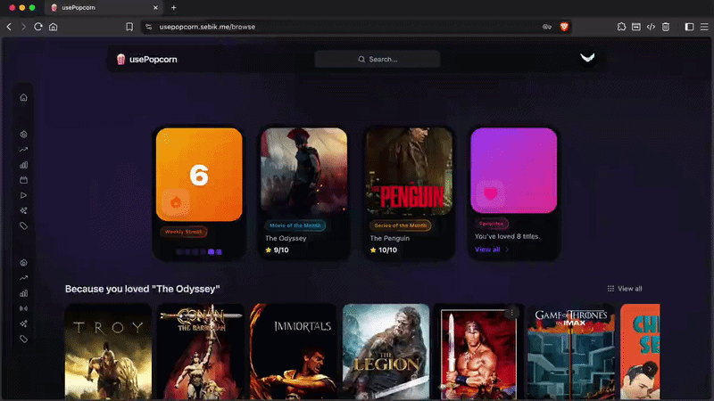
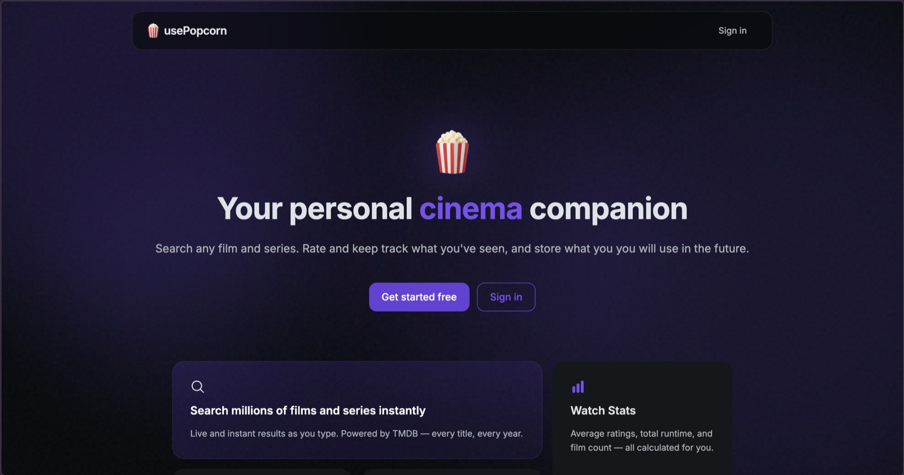
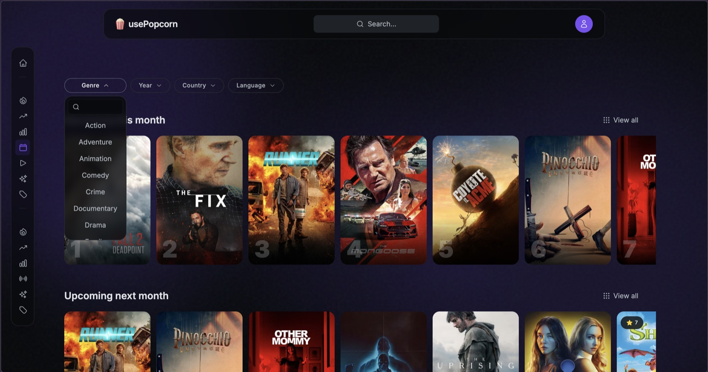
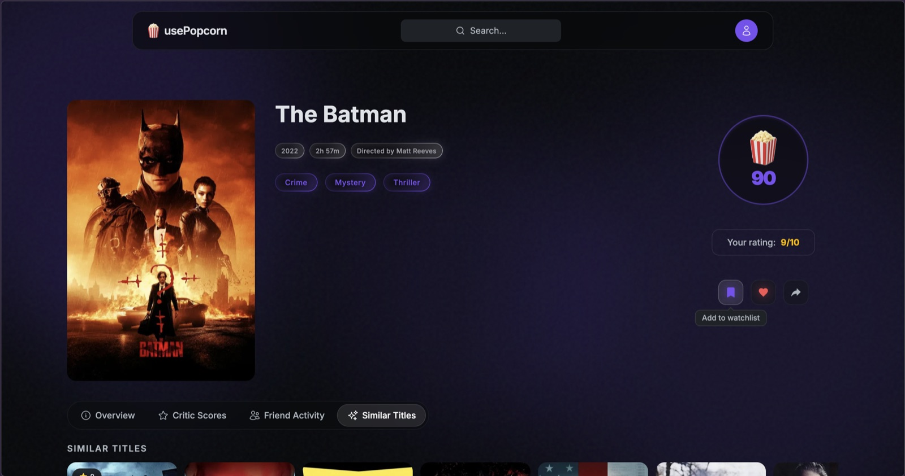
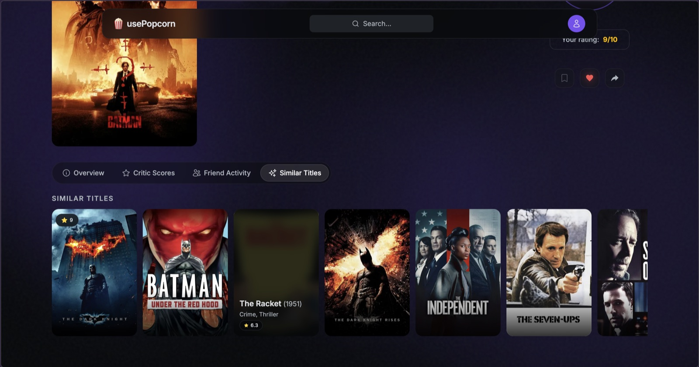
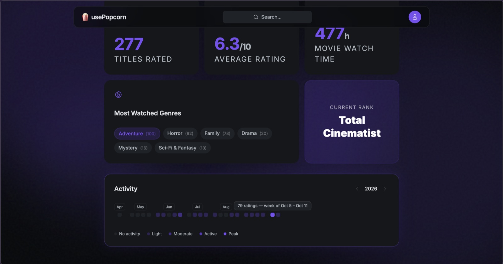
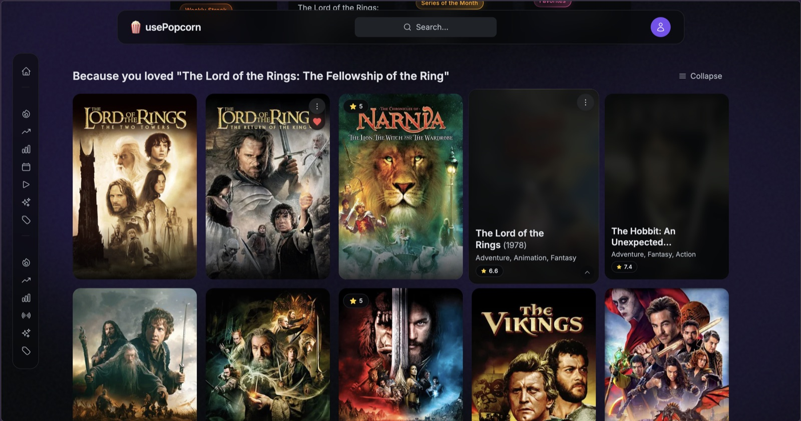

# usePopcorn

A movie and series discovery and social tracking platform. Users browse TMDB catalogues, rate titles, follow other users, and get analytics on their own viewing history. Analytics, aggregation and social-graph queries run inside PostgreSQL as 12 custom PL/pgSQL / SQL functions. The client receives pre-shaped `jsonb` or scalar results, not raw rows to reduce.

<p align="center">
  <a href="https://usepopcorn.sebik.me/"></a>
  <a href="https://github.com/sebi-development/usepopcorn/actions/workflows/ci.yml"></a>
  <a href="LICENSE"></a>
</p>

<p align="center">
  
  
  
  
  
  
  
</p>

<p align="center">
  
</p>

### Try it in 30 seconds

**[usepopcorn.sebik.me](https://usepopcorn.sebik.me/)**. Sign in with the shared demo account, or register your own.

| | |
|---|---|
| **Demo email** | `demo1@test.com` |
| **Demo password** | `demo1234` |

### Screenshots

| | |
|---|---|
| <br>**Landing.** Eager-loaded first paint, auth entry points. | <br>**Browse + URL-driven filters.** Genre, year, country, language. Filtered at TMDB, shareable as a link. |
| <br>**Title page.** One request via `append_to_response`, optimistic rating and favourite / watchlist toggles. | <br>**Overview · Critic Scores · Friend Activity · Similar Titles.** Everything about a title in one tabbed page. |
| <br>**Profile analytics.** Totals, top genres and the weekly heatmap are each computed by one PostgreSQL function. | <br>**Recommendations.** Seeded from the user's best-rated title of the month, expands into a paged grid. |

### What makes this more than a TMDB client

| | |
|---|---|
| **Analytics in the database** | 12 PL/pgSQL / SQL functions (CTEs, window functions, `generate_series`) return pre-shaped `jsonb`. Streak, heatmap and genre ranking are one round trip each, with no client-side reducing. [Details](#3-deep-dive-custom-database-engine) |
| **No application server** | The browser talks to Supabase and TMDB directly; external scores (MDBList, ČSFD) come through two Supabase Edge Functions that hold the keys and cache the results in Postgres. Authorization is Row Level Security on every table plus `SECURITY INVOKER` read functions, with `anon` locked out. [Security notes](#security-notes) |
| **Realtime social feed** | Followed users' ratings arrive over `postgres_changes` with server-side row filters, keyset-paged, and filterable by type, score, genre, friend and period. |
| **One cache vocabulary** | Five named cache tiers and a `queryKeys` factory that ESLint enforces, so a query, its invalidation and its realtime subscription cannot drift apart. [Cache strategy](#22-client-cache-strategy-and-speculative-prefetching) |
| **URL is the state** | Browse and feed filters are one shared, URL-driven layer. A filtered view is a link, and Back restores it. [Filtering](#221-url-driven-filtering) |
| **Database as code** | Every schema change is a migration file, applied with the Supabase CLI. Live RPC definitions are snapshotted in `supabase/functions-reference/`. [Workflow](#database-workflow) |
| **Continuous integration** | Every pull request runs lint and a production build in GitHub Actions ([`ci.yml`](.github/workflows/ci.yml)). |

### Where to look first

If you have five minutes, these files show the shape of the codebase:

| Question | File |
|---|---|
| How is server state organised? | [`src/lib/queryClient.js`](src/lib/queryClient.js), [`src/lib/queryKeys.js`](src/lib/queryKeys.js) |
| How do the two-tier streak queries work? | [`src/features/profile/hooks/useProfileStreak.js`](src/features/profile/hooks/useProfileStreak.js) and [`get_extended_streak.sql`](supabase/functions-reference/get_extended_streak.sql) |
| How is realtime wired to the cache? | [`src/features/social/hooks/useFeedRealtime.js`](src/features/social/hooks/useFeedRealtime.js) |
| How do paged lists share one system? | [`src/hooks/usePagedList.js`](src/hooks/usePagedList.js), [`src/utils/pagination.js`](src/utils/pagination.js) |
| How are filters modelled? | [`src/hooks/useUrlFilters.js`](src/hooks/useUrlFilters.js), [`src/utils/filters.js`](src/utils/filters.js) |
| How are routes split and prefetched? | [`src/App.jsx`](src/App.jsx), [`src/layout/AppLayout.jsx`](src/layout/AppLayout.jsx) |
| What does the database look like? | [`supabase/migrations/`](supabase/migrations), [`supabase/functions-reference/`](supabase/functions-reference) |

---

- **Client:** React 19, Vite, Tailwind CSS v4, TanStack Query v5, React Router v7 (data router)
- **Backend:** Supabase (Auth, PostgreSQL, Realtime, Storage, Edge Functions). There is no application server. The browser talks to Supabase (PostgREST, RPC, and two Edge Functions for external scores) and to TMDB directly.
- **Language:** plain JavaScript / JSX, no TypeScript, no test suite. Lint: ESLint 10 flat config.

---

## 1. Architecture Overview

### Data flow

Data moves through three layers, and each layer has one job.

| Layer | Location | Responsibility |
|---|---|---|
| **Services** | `src/services/*` | Plain async functions with no React. `tmdb.js` wraps `fetch`. `mdblist.js` / `csfd.js` read a score cache table and call their Edge Function only when the row is missing or expired. The rest (`ratings`, `follows`, `profiles`, `interactions`, `files`) call Supabase through one shared client (`src/lib/supabase.js`). Every function throws `Error` so React Query can surface it. |
| **Hooks** | `src/features/<feature>/hooks/*` | `useQuery` / `useInfiniteQuery` / `useMutation` wrappers. Third-party payloads (TMDB, MDBList, ČSFD) are normalised in the `queryFn`, not in `select`, so the cache holds only the fields the UI reads (a raw TMDB title is ~200 KB, a season ~100 KB). Mutations use optimistic updates: `onMutate` snapshot, `onError` rollback, `onSettled` invalidate. |
| **Components** | `src/features/<feature>/components`, `src/components/{ui,media}`, `src/pages/*` | Presentation. Shared primitives are `React.memo`-ed. |

### Auth gate and current user

`src/layout/AppLayout.jsx` guards every `/browse`, `/profile` and `/community` route. It resolves the Supabase session, redirects to `/login` when there is none, and **seeds the `queryKeys.currentUser` cache entry** from the session. `onAuthStateChange` keeps it in sync. `useCurrentUser()` reads that entry (`staleTime: Infinity`, `gcTime: Infinity`) and never fetches, so identity resolution costs zero extra round trips. Auth state is cached at boot and changes only through the auth listener.

---

## 2. Core Architectural Pillars

### 2.1 Offloading heavy computation to PostgreSQL RPCs

The profile analytics are set-based problems: gap detection over time series, per-type genre ranking after unnesting an array column, and calendar densification. PostgreSQL solves these in one pass over an index-scannable `ratings` slice. Doing them in the client would mean streaming every rating row for the user and reducing them in JavaScript.

| Concern | Where it runs | Effect |
|---|---|---|
| **Weekly streak, unbounded history** (`get_extended_streak`) | DB: gaps-and-islands variant. `generate_series` builds a dense week calendar, a `LEFT JOIN` marks activity, and `max(week_start) WHERE NOT had_activity` finds the most recent gap. | The client receives **one `integer`**. Without this it would receive one row per rating ever made. |
| **Annual activity heatmap** (`get_profile_heatmap`) | DB: `generate_series` over the week range, `LEFT JOIN`, `GROUP BY`, `jsonb_agg(... ORDER BY week_start)`. | The client receives at most 53 `{weekStart, count}` objects, including zero-weeks that a plain `GROUP BY` would drop. The grid renders without client-side date bucketing. |
| **Genre breakdown / totals** (`get_profile_stats`) | DB: `unnest(genre_ids)`, then `row_number() OVER (PARTITION BY type ORDER BY genre_count DESC)`, keeping ranks ≤ 3 per type. | The client gets one `jsonb` document with counts, average score, watch-hours and top-3 genres per media type. |

**Two-tier streak evaluation.** The streak card shows how the cheap and the expensive query are combined (`src/features/profile/hooks/useProfileStreak.js`):

1. `get_recent_weekly_activity` returns a fixed 12-week window. The client drops the in-progress week and counts back from the latest completed week.
2. Only if all 11 completed weeks in that window have activity (`isSaturated`) does the client enable the second query, `get_extended_streak`. The unbounded gap-detection query therefore runs only for users who could exceed the window.

Both queries use `staleTime: 15 min`.

**Payload shape:** RPCs that return `jsonb` return the exact shape the component consumes (`{ year, joinedAt, weeks: [...] }`, `{ totalRated, averageScore, topGenres: [...] }`). No client-side `reduce`, `groupBy` or date arithmetic sits between the response and the render.

### 2.2 Client cache strategy and speculative prefetching

Every query spreads a cache tier from `CACHE` in `src/lib/queryClient.js` instead of ad-hoc numbers, and every key comes from the `queryKeys` factory in `src/lib/queryKeys.js` (queries, invalidations, optimistic updates and prefetches alike; ESLint rejects an inline `queryKey: [...]`). The global default is the `user` tier, with `retry: 1` and no refetch on window focus.

| Tier | `staleTime` / `gcTime` | Used for |
|---|---|---|
| `ephemeral` | 0 / 1 min | Search-as-you-type. One entry per typed term, useless once the text moves on. |
| `user` | 5 / 10 min | The signed-in user's own Supabase data. Mutations and realtime invalidate it. |
| `aggregate` | 15 / 10 min | Stats, streak, best-rated picks, suggestions. Invalidated on write, otherwise slow-moving. |
| `media` | 15 / 30 min | One title's or season's TMDB metadata. |
| `mediaList` | 15 / 15 min | Browse rows and grids, recommendations. `gcTime` equals `staleTime` because data past `staleTime` refetches anyway, so holding it longer only keeps stale objects in memory. |
| `filtered` (override) | `gcTime` 2 min | Spread on top of a tier by `filteredCache(tier, filters)` for a list narrowed by filters. A filter combination is mostly viewed once, so it only outlives its screen long enough to open a title and come back. `staleTime` stays the source tier's. |

One case sits outside the tiers on purpose: the current user (`∞` / `∞`, seeded from the session and changed only by the auth listener or `setQueryData`). External scores use the `media` tier: their long-lived cache is the Postgres table behind each Edge Function (7–90 days by title age), not the browser.

**Trimmed cache payloads.** TMDB responses are reduced in the `queryFn`, and list items go through `toMediaItem` (`src/utils/tmdbItem.js`). Series details no longer request credits. In a scripted session (Home, three browse rows, three movies, two series with episodes, a search, a profile) the cached data went from 2090 KB to 108 KB.

**Shared page 1.** A row that shows the first page of a numbered grid uses `queryKeys.gridPage(base, 1)`, so expanding it is a cache hit. "Am I following X" is read from the followed-ids list (`useFollowingIds`), which `useFollow` patches optimistically, so a profile makes no per-user follow requests.

**One media-state query.** `get_my_media_state` returns the user's favourites, watchlist and own ratings in one round trip. The derived lookups are memoised on the payload, so every `MediaRow` shares one set of `Set`s and `MediaCard` receives primitives.

**One pagination system.** All paged lists share the contract in `src/utils/pagination.js`: sources are adapted to `{ items, nextCursor, totalPages?, total? }` by `fromTmdb`, `fromCursorRpc` and `fromRange`, then consumed by two hooks.

- `usePagedList` is an infinite list over `useInfiniteQuery`, hard-capped at `MAX_PAGES = 5`. Its `phase` (`auto` → `manual` → `capped` / `done`) drives `LoadMoreFooter`: a scroll sentinel for the first `AUTO_PAGES = 3`, then a "Load more" button, then an end note. The Community feed and the friend activity grid use it. Browse and Home rows use it with `autoPages: MAX_PAGES` and no button phase.
- `usePagedGrid` keeps one query per numbered page (`queryKeys.gridPage`), with `placeholderData: keepPreviousData` and a prefetch of page *N+1* once page *N* lands. The prefetch stops at `min(total_pages, 500)`, because TMDB returns 400 past page 500. The Browse and recommendation "View all" grids and the profile "Recently rated" grid use it, and `useExpandableGrid` holds their expand and page state. The UI dims the old grid while `isPlaceholderData || isFetching` instead of unmounting it, so nothing suspends and there is no skeleton flash.

Supabase RPCs page by keyset cursor `(created_at, id)`, so deep pages cost the same as the first. The cursor timestamp is passed back as the string PostgREST returned, and `p_limit` is clamped to 50 server-side.

**Realtime invalidation, not polling.** `useFeedRealtime` and `useAverageRatingRealtime` subscribe to Supabase `postgres_changes` on `ratings`, with server-side filters (`user_id=in.(…)` for followed users, `tmdb_id=eq.<id>`). Each event calls `invalidateQueries` (or patches a score in place) with the exact key the reader uses, and both sides take it from `queryKeys` (`queryKeys.feed(userId)`, `queryKeys.ratings.average(tmdbId)`), so they cannot drift apart. Channels are torn down on unmount, and the following-id list is sorted and joined into a stable string so the channel is not resubscribed on every render.

**Route-level speculative loading.** `src/App.jsx` splits routes into tiers, and `AppLayout` runs a prefetch cascade once per session:

| Tier | Chunks | Loaded |
|---|---|---|
| T0 (eager) | Landing, Login, Register, NotFound | First paint |
| T1 | `BrowsePage` | Prefetched as soon as the session resolves, during the auth spinner |
| T2 | `ProfilePage`, `DetailPage` (plus `ForgotPassword` / `ResetPassword` on demand) | `requestIdleCallback` slot |
| T3 | `CommunityPage`, `ProfileStatsPage` | Later `requestIdleCallback` slot |

`requestIdleCallback` has a `timeout: 3000` and a `setTimeout` fallback. Prefetch failures are swallowed, because the route's `lazy` loader imports the module again on navigation.

Pages are data-router `lazy` routes, not `React.lazy` + `<Suspense>`. The router loads the module before it renders the route, so nothing suspends. A `React.lazy` page always suspends on its first render, and React 19 reveals a suspended boundary no sooner than 300 ms after its fallback appeared (`FALLBACK_THROTTLE_MS`), which on a cold load of `/browse` held the page back ~280 ms after its code had arrived.

**Render-as-you-fetch on `/browse`.** A route `loader` runs in parallel with the route's `lazy` import, so `browseLoader` starts Home's above-the-fold queries (media state, profile stats, best-rated picks) next to the BrowsePage chunk download instead of after it. It does not await them: the hooks pick up the in-flight requests through the shared query option factories (`bestRatedQuery`, `profileStatsQuery`, `mediaStateQuery`), so each is requested once. Under a throttled mobile profile (4× CPU, 150 ms RTT, 1.6 Mbps) the best-rated request starts ~520 ms earlier and LCP drops from ~3.3 s to ~2.9 s.

**Optimistic mutations.** Rating upsert follows `cancelQueries` → snapshot → `setQueryData` → rollback on error → invalidate on settle (`invalidateRatingQueries`). Ratings, average rating, profile stats, best-rated picks and every heatmap year refresh from `onSettled`. Favourite / watchlist toggles and follows patch their caches the same way.

### 2.2.1 URL-driven filtering

Browse and the Community feed share one filter layer. The URL is the single source of truth, so a filtered view is a shareable link and Back restores it. Filtering is done at the source (TMDB `/discover`, the `get_user_feed` RPC), never by trimming a loaded list on the client.

| Surface | Filters | Source | `multi` (OR) |
|---|---|---|---|
| Browse (movies / series) | genre, year, country, language | TMDB `/discover`, values pipe-joined | genre, country, language. `/discover` takes one exact year, so year is a `select`. |
| Friends Activity feed | type, score, genre, friend, period | optional parameters of `get_user_feed` (`p_type`, `p_min_score`, `p_genre_ids`, `p_user_ids`, `p_since`) | genre, friend |

- **Defs, not special cases.** A surface describes its filters as `{ key, label, kind: 'select' | 'multi', options }` (`features/browse/constants/filters.js`, `features/social/constants/feedFilters.js`). `useUrlFilters(defs)` parses the URL into a normalised `filters` object with a stable identity, so it goes straight into query keys without re-keying on every render. `FilterBar` / `FilterPill` render pills and removable value chips from the same defs.
- **Unfiltered stays untouched.** Categories without a filter keep their own TMDB endpoints and keys. Any active filter switches to `/discover` under `queryKeys.media.discover`; the feed gets one `queryKeys.feed.list(userId, filters)` entry per combination under `feed.all(userId)`, which realtime and follow/unfollow refresh together.
- **One request per burst of ticks.** A multi pill keeps its picks as a draft and commits them 400 ms after the last tick or when it closes, so ticking three genres is one URL change, one request and one cache entry. A pick that returns to the committed value cancels the pending commit.
- **Short-lived cache entries.** Filtered lists take the `filtered` override (`gcTime` 2 min), so exploring combinations does not accumulate memory.
- **Live count without duplicating SQL.** With filters on, `useFeedRealtime` does not re-implement the filter in JS. It asks `get_user_feed` which of the unseen live ratings match (`limit = unseen.length`, one small request, `queryKeys.feedFilterMatches`) and counts those, so the SQL stays the only definition of a filter. A re-score still patches the card in place in every filtered variant.
- **Motion.** A pill grows into its option list with one WAAPI timing for its width and the list's clip-path (`ease-out-quint`, snaps under `prefers-reduced-motion`). Widths are measured with `getBoundingClientRect`, because the rounded `offsetWidth` left a pill a fraction of a pixel short and its label truncated mid-animation. Lists over 8 options get a search that is never auto-focused, so no caret and no mobile keyboard pop up on open.
- **Database.** Migrations `feed_filters` and `feed_filter_friends` add the optional parameters and turn the friend filter into `p_user_ids uuid[]` (old signature dropped in the same migration, because new parameters would otherwise create an overload).

### 2.3 Relational integrity and boundary normalisation

- **One vocabulary across the boundary.** TMDB names the series media type `tv` (`/tv/{id}`, `/discover/tv`). The browse UI says "Series". Two mappings exist (`SECTION_TO_TYPE = { movies: 'movie', series: 'tv' }` and the `FETCH_MAP` section keys), and they are resolved once, at the routing boundary in `useCategoryMedia.js`. The `ratings.type` column stores TMDB's own values (`'movie'` | `'tv'`), and the RPCs filter on them directly (`count(*) filter (where type = 'tv')` in `get_profile_stats`). The value the client writes is the same value used in TMDB URLs and in SQL predicates, so there is no runtime translation step. `ratings` enforces it with a `CHECK (type IN ('movie','tv'))` constraint, and `user_media_interactions.media_type` accepts the same two values (it used to accept `'series'`, which made adding a series to the watchlist fail).
- **Idempotent writes via composite key.** Ratings are written with `upsert(..., { onConflict: 'user_id,tmdb_id' })`. This relies on a composite unique constraint on `(user_id, tmdb_id)`, which gives "one rating per user per title" without a read-before-write and makes a re-rate a single statement. The same constraint gives the index that serves the `WHERE user_id = … AND tmdb_id = …` lookups, so no separate duplicate index is needed on those columns.
- **Follows** are `(follower_id, following_id)` edges. Social RPCs join `ratings ⨝ follows ⨝ profiles` on those keys.
- **Profile lifecycle.** A `SECURITY DEFINER` trigger, `handle_new_user()`, creates the `profiles` row from `auth.users.raw_user_meta_data`, so signup is atomic and the client never writes a profile row itself. `delete_user()` deletes `auth.users` where `id = auth.uid()`, which comes from the verified JWT and cannot be spoofed by an argument. This removes the account, and cascades depend on the schema's foreign keys.
- **Data normalisation at both ends.** The Edge Functions store only the scores (MDBList's ~3 KB response becomes five columns), and the hooks shape them for the UI in the `queryFn` (`{ imdb, rtCritics, rtAudience, metacritic, rtUrl }`, `{ rating, url }`), so components never see a provider's raw shape.

### 2.4 Component geometry and design system

- **Slot-based `FeatureCard`** (`src/components/ui/FeatureCard.jsx`). It exposes `heroBackground`, `heroContent`, `floatingIcon` and `children` slots and is wrapped in `React.memo`. The streak card and the home-page feature cards are compositions of this one primitive, and it ships a matching `FeatureCardSkeleton` with identical geometry, so loading and loaded states occupy the same box (no layout shift).
- **Concentric corner radii (`inner = outer − padding`).** The hero panel is nested in the card with padding `p-2` (0.5 rem). On `sm+` the outer radius is `rounded-4xl` (2 rem) and the inner is `rounded-3xl` (1.5 rem), which is exactly `2rem − 0.5rem`, so the inner curve is concentric with the outer one. Below `sm` the card uses `1.75rem` outer with `p-1.5` and a `1.25rem` inner radius.
- **Grid.** Cards use `aspect-2/3 h-full w-full`, so every card in a grid row matches the tallest sibling. The hero occupies a fixed 72% of the card height, and card grids reflow with responsive CSS Grid columns, not JS measurement.
- **Design tokens.** Colours and radii are defined once in `@theme` in `src/index.css` (`--color-primary`, `--color-surface-*`, `--radius-card`). Tailwind v4 generates utilities from these tokens.
- **Phone layout (320-430 px).** Controls reach 44 px below `md`, either by size or by an invisible `::before` that pads the tap area without moving anything, and get `touch-action: manipulation`. Form inputs are 16 px below `md` so iOS Safari does not zoom the page on focus, and primary actions are 52 px tall. Hover-only controls (avatar edit / remove, row scroll arrows) are not tappable while invisible. Full-height layouts use `dvh`, not `vh`. `pnpm audit:mobile` checks tap targets and overflow per screen.
- **Rendering discipline.** Presentational components are memoised, callbacks passed down use `useCallback`, and static arrays and objects are hoisted out of render bodies. Light tab panels toggle with `hidden`/`block` plus `role="tabpanel"` and `aria-hidden` and are not unmounted, so their DOM and query subscriptions persist across tab switches.

---

## 3. Deep Dive: Custom Database Engine

Twelve functions live in `public` (the trigger function also depends on the `auth` schema), plus the `set_updated_at` trigger function that keeps `ratings.updated_at` current. The client reaches ten of them through `supabase.rpc(...)`. `handle_new_user` is invoked by the database on signup.

| # | Function & signature | Returns | Algorithmic strategy | Security posture |
|---|---|---|---|---|
| 1 | `handle_new_user()` | `trigger` | Trigger on `auth.users`. Inserts `(id, username, country)` into `public.profiles`, with `username` and `country` read from `raw_user_meta_data ->> …`. | `SECURITY DEFINER` with an empty `search_path`. Runs as the function owner so it can write `profiles` during signup, before the user has a session. |
| 2 | `delete_user()` | `void` | Single `DELETE FROM auth.users WHERE id = auth.uid()`. `auth.uid()` reads the caller's verified JWT, so there is no user-supplied identifier to spoof. | `SECURITY DEFINER`, `search_path = 'public', 'auth'`. `anon` cannot execute it. |
| 3 | `get_extended_streak(p_user_id uuid)` | `integer` | CTE chain: `my_ratings` (distinct `date_trunc('week', created_at)`) → `week_range` (`generate_series` from first active week to last completed week) → `weekly_activity` (`LEFT JOIN`, `had_activity` flag) → `most_recent_gap` (`max(week_start) WHERE NOT had_activity`). Result is `count(*)` of weeks after the latest gap (or from the first week if there is none). Current, incomplete week excluded. | `SECURITY INVOKER`, `STABLE`, so RLS applies |
| 4 | `get_profile_stats(p_user_id uuid)` | `jsonb` | `unnest(genre_ids)` per type → `GROUP BY type, genre_id` → `row_number() OVER (PARTITION BY type ORDER BY genre_count DESC)`; keeps `rank <= 3`. Scalars via `count(*) FILTER (WHERE type = …)`, `round(avg(score), 1)` and `sum(runtime) FILTER (WHERE type = 'movie') / 60.0` for watch-hours. Assembled with `jsonb_build_object` / `jsonb_agg`. | `SECURITY INVOKER`, `STABLE`, so RLS applies |
| 5 | `get_profile_heatmap(p_user_id uuid, p_year integer)` | `jsonb` | `generate_series` of weeks from `max(joined_at, Jan 1)` to `min(Dec 31, today)`, `LEFT JOIN` to ratings on `date_trunc('week', created_at)`, `GROUP BY week`, `jsonb_agg(... ORDER BY week_start)`. Zero-activity weeks are preserved. Also returns `joinedAt`. | `SECURITY INVOKER`, `STABLE`, so RLS applies |
| 6 | `get_recent_weekly_activity(p_user_id uuid, p_weeks integer DEFAULT 12)` | `jsonb` | Same dense-calendar pattern over a rolling window of `p_weeks` weeks ending at the current week. Fixed-size output (12 by default). | `SECURITY INVOKER`, `STABLE`, so RLS applies |
| 7 | `get_best_rated_since(p_user_id uuid, p_since timestamptz)` | `jsonb` | `DISTINCT ON (type)` over the user's `movie` / `tv` ratings with `updated_at >= p_since`, `ORDER BY type, score DESC, updated_at DESC`, so each type keeps its best-scored rating (ties go to the most recently updated). `jsonb_object_agg(type, to_jsonb(t))` folds the two rows into one `{ movie, tv }` object (`{}` when the window is empty), each pick carrying `type`, `tmdb_id`, `title`, `poster_path`, `rating`. The client passes calendar-snapped windows from `src/utils/periods.js`: the month for the "of the Month" cards, then 3, 6 and 12 months as fallbacks that seed the recommendation rows, which then call TMDB `/recommendations`. | `SECURITY INVOKER` (default), marked `STABLE`, so RLS applies |
| 8 | `get_average_rating(p_tmdb_id integer)` | `numeric` | `ROUND(AVG(score)::numeric, 1)` over all ratings for a title. | `SECURITY INVOKER` (default), marked `STABLE` |
| 9 | `get_user_feed(current_user_id uuid, p_limit integer DEFAULT 20, p_cursor_created_at timestamptz, p_cursor_id uuid, p_type text, p_min_score integer, p_genre_ids integer[], p_user_ids uuid[], p_since timestamptz)` | `TABLE(id, tmdb_id, title, poster_path, type, score, created_at, user_id, username, avatar_url)` | `ratings ⨝ follows ON r.user_id = f.following_id ⨝ profiles`, filtered by `f.follower_id = current_user_id`, ordered by `(created_at, id) DESC` and paged by keyset cursor. `p_limit` is clamped to 50, so the client receives one small page of fully-hydrated rows at a time. The optional `p_*` filters (type, minimum score, any-of genres, any-of followed users, since) are applied in the same query, and are `null` when unused. | `SECURITY INVOKER`, `STABLE`, so RLS applies |
| 10 | `get_friends_ratings(current_user_id uuid, p_tmdb_id integer, p_limit integer DEFAULT 12, p_cursor_created_at timestamptz, p_cursor_id uuid)` | `TABLE(rating_id, score, created_at, user_id, username, avatar_url, total_count)` | Same three-way join, restricted to a single `tmdb_id`, with the same keyset paging and `total_count` for the grid. Drives the friend activity tab on a title's page. | `SECURITY INVOKER`, `STABLE`, so RLS applies |
| 11 | `get_suggested_users(current_user_id uuid)` | `TABLE(id, username, avatar_url, recent_activity_count, mutual_friend_count, suggestion_score)` | Three CTEs: `my_follows`, `user_activity` (ratings in the last 14 days, `GROUP BY user_id`) and `mutual_connections` (for users followed by people I follow, `count(follower_id)`). Score = `mutual × 10 + activity`. Excludes self and already-followed users via `NOT EXISTS`, requires `score > 0`, `ORDER BY suggestion_score DESC LIMIT 4`. | `SECURITY INVOKER`, `STABLE`, so RLS applies |
| 12 | `get_my_media_state()` | `jsonb` | Three scalar subqueries over the caller's `user_media_interactions` (favourites, watchlist) and `ratings`, filtered on `(select auth.uid())` so the planner uses an InitPlan and an index scan on `ratings`. Returns `{ favorites: [tmdb_id], watchlist: [tmdb_id], ratings: { "<tmdb_id>": score } }`. One round trip answers "favourited / watchlisted / my score" for every card on screen. | `SECURITY INVOKER`, `STABLE`, so RLS applies |

### Selected implementations

**Weekly streak via gap detection** (`get_extended_streak`). It is a dense-calendar variant of gaps-and-islands. Only the most recent island matters, so it needs no `row_number()` difference trick: it finds the last inactive week and counts the weeks after it.

```sql
with my_ratings as (
  select distinct date_trunc('week', created_at)::date as week_start
  from ratings where user_id = p_user_id
),
week_range as (
  select generate_series(
    (select min(week_start) from my_ratings),
    date_trunc('week', current_date - interval '1 week')::date,
    interval '1 week')::date as week_start
),
weekly_activity as (
  select w.week_start, (r.week_start is not null) as had_activity
  from week_range w left join my_ratings r on r.week_start = w.week_start
),
most_recent_gap as (
  select max(week_start) as gap_week from weekly_activity where not had_activity
)
select count(*)::int
from weekly_activity, most_recent_gap
where week_start > coalesce(most_recent_gap.gap_week,
                            (select min(week_start) from weekly_activity) - interval '1 week');
```

**Top genres per media type** (`get_profile_stats`):

```sql
genre_counts as (
  select type, unnest(genre_ids) as genre_id, count(*) as genre_count
  from my_ratings group by type, genre_id
),
ranked_genres as (
  select type, genre_id, genre_count,
         row_number() over (partition by type order by genre_count desc) as rank
  from genre_counts
)
-- …jsonb_agg(...) where rank <= 3
```

**Suggestion scoring** (`get_suggested_users`), a weighted mutual-graph plus recency score:

```sql
(COALESCE(mc.mutual_count, 0) * 10 + COALESCE(ua.activity_count, 0)) AS suggestion_score
```

### Security notes

- **Row-level security.** Every policy is scoped to the `authenticated` role. Own-row predicates use `(select auth.uid())`, which Postgres evaluates once per statement as an InitPlan instead of once per row, and the read-for-every-signed-in-user policies are `using (true)`. A per-row `auth.uid()` filter is a security qual that stops non-leakproof user filters from becoming index conditions, so this also lets `username ilike '%x%'` use its trigram index and `get_my_media_state` use an index scan.
- **No `SECURITY DEFINER` reads.** All read RPCs (including the four profile analytics functions) are `SECURITY INVOKER`, so RLS stays in force. They take a `p_user_id` parameter because the app renders other users' public profiles (`/profile/:userId`), and RLS already lets every signed-in user read `ratings` and `profiles`. Anonymous callers get nothing: when the analytics functions were `SECURITY DEFINER` and executable by `anon`, anyone holding the public anon key and a user uuid from a `/profile/<uuid>` URL could read that user's stats, heatmap and streak.
- Only `delete_user` and `handle_new_user` are `SECURITY DEFINER`, both with a pinned `search_path`. `delete_user()` accepts no arguments, the target is derived from the JWT, and `anon` cannot execute it.
- Read-only functions are marked `STABLE`. At the current table sizes this changes no measurable timing, but it is correct (read-only transaction) and good planner hygiene.
- Indexes: `follows` is indexed by `following_id` (mutual friends in `get_suggested_users`, cascade on profile delete), and `ratings (user_id, updated_at desc)` serves the windowed best-rated query.
- The Supabase **anon key** and the TMDB key are `VITE_`-prefixed and are therefore embedded in the client bundle. Authorization has to come from RLS and the RPC design above. The TMDB key should be treated as a public, low-privilege, rate-limited credential.
- The MDBList key is not in the bundle: it is a Supabase secret (`MDBLIST_API_KEY`) that only the `mdblist-scores` Edge Function reads, so its daily quota can't be spent from outside. Both score functions require a signed-in user's JWT (`verify_jwt`), and only they can write the score cache tables (`service_role`); signed-in users can only read them.

### Database workflow

The project is linked to the production database through the Supabase CLI (a devDependency). There is no local database and no Docker, so `db pull`, `db dump`, `db diff` and `supabase start` are not used.

- Every schema change is a migration file in `supabase/migrations/`: `pnpm db:new <name>`, write the SQL, `pnpm db:dry` to list what would be applied, then `pnpm db:push`. Migrations run on production untested, so they are small and idempotent (`create or replace function`, `if not exists`, drop the old signature when parameters change).
- `pnpm db:query "<sql>"` (or `-f file.sql`) runs read-only inspection SQL through the Management API.
- `supabase/migrations/` only holds changes from 2026-10-01 on. The earlier schema exists only in the live database.
- `supabase/functions-reference/*.sql` is a read-only snapshot of the live RPCs and triggers for context. It is not applied and can go stale, so re-read the live definition before changing a function.
- Auth email templates live in `supabase/templates/`.

---

## 4. Key Features

**Discovery**
- Category rails for movies and series (trending, popular, top rated, now playing / on the air, two rolling *upcoming* windows) and per-genre `/discover` rows.
- Each row is an infinite-scrolling horizontal strip that expands into a paginated grid, with `keepPreviousData` transitions and next-page prefetch (see 2.2).
- Filters on every Browse category: genre, year, country and language (multi-select where TMDB can OR the values), URL-driven so a filtered view is a link. See 2.2.1.
- Debounced title search, overlay results, and user search.
- Title pages with tabbed Overview / Scores / Seasons / Friend Activity panels. TMDB details are fetched with `append_to_response` (credits, providers, release dates or content ratings, external IDs) to keep it to one request. IMDb, Rotten Tomatoes (critics and audience) and Metacritic scores come from MDBList by TMDB id, and the ČSFD rating by IMDb id, each through its own Edge Function and Postgres cache. Season details load lazily, only after the Seasons tab is visited.
- Favourites and watchlist toggles (optimistic), for movies and series, behind an actions menu on each card. Cards also show the signed-in user's own rating as a star chip.
- Movie and series recommendation rows seeded from the user's movie and series of the month (`get_best_rated_since`, then TMDB `/recommendations`), widening to the last 3, 6 or 12 months when a type has no pick and labelling the window used.

**Social**
- Feed of followed users' ratings (`get_user_feed`), live-updated over Realtime and keyset-paged: one page on arrival, then a "Load more" button, capped at three pages.
- Feed filters: type, minimum score, genre, friend and period, resolved server-side. New ratings that arrive while a filter is on are counted only if they match it.
- Mutual-friend suggestions (`get_suggested_users`, `mutual × 10 + 14-day activity`).
- Inline friend ratings on each title (`get_friends_ratings`), 12 per page behind a "Load more" button.
- Follow / unfollow with follower and following counts, public profile pages.
- Live community average rating on each title (`get_average_rating` plus a Realtime subscription filtered by `tmdb_id`).

**Analytics**
- "Recently rated" row with a numbered "View all" grid for the full rating history.
- Annual activity heatmap (`get_profile_heatmap`, per year).
- Running weekly streak (two-tier, described in 2.1).
- Movie and series "of the Month" highlight cards (`get_best_rated_since`).
- Totals, average score, watch-hours and top-3 genres per media type (`get_profile_stats`).

**Account**
- Email/password auth with password recovery, profile editing (username, country, email, password), avatar upload and removal via Supabase Storage, and self-service account deletion through `delete_user()`.

---

## 5. Tech Stack

| Layer | Technology | Strategic tradeoff |
|---|---|---|
| Frontend | **React 19** | Concurrent renderer and `React.memo` / `lazy` / `Suspense` primitives (with React Router's route-level `lazy` for pages) cover the rendering and splitting needs. No framework runtime (Next.js / Remix) is needed for a client-rendered app behind an auth gate, so there is no SSR complexity and static hosting is enough. |
| Frontend | **Vite 8** | Native-ESM dev server and Rollup production build with automatic chunking for every dynamic `import()`. |
| Frontend | **React Router v7** (`createBrowserRouter`) | Data-router API with nested layouts (`PublicLayout` / `AppLayout`), and the auth gate lives in a layout route rather than being repeated per page. |
| Frontend | **Tailwind CSS v4** (`@tailwindcss/vite`) | Zero-runtime styling with tokens declared in `@theme`. Removes CSS-in-JS runtime cost and keeps geometry (radii, aspect ratios) declarative. |
| Frontend | react-hook-form, react-hot-toast, date-fns, react-icons | Uncontrolled form inputs (fewer re-renders than controlled forms), small toast surface, and tree-shakeable date and icon imports. |
| State / cache | **TanStack Query v5** | Handles server state, request deduplication, `staleTime` / `gcTime` control, `keepPreviousData`, `prefetchQuery` and optimistic mutations. A global store (Redux/Zustand) would mean reimplementing cache invalidation by hand. There is no client-side state library beyond it and local `useState`. |
| Backend / DB | **Supabase / PostgreSQL** | Relational data (ratings ⨝ follows ⨝ profiles) with real SQL: CTEs, window functions and `generate_series` power the analytics. A document store would push joins and aggregates into the client. Supabase also provides Auth, Realtime and Storage without a custom server. |
| Backend / DB | **PL/pgSQL / SQL RPCs** | Aggregation runs next to the data, and the wire carries small pre-shaped results. The tradeoff is that logic lives in the database and needs migration discipline, and the DB CPU is shared across users. |
| Backend / DB | **Supabase Realtime** (`postgres_changes`) | Push-based invalidation for feed and average ratings, with server-side row filters, instead of polling. |
| Backend / DB | **Supabase Edge Functions** (Deno) | The only server-side code: two score lookups that need a secret or can't run in a browser. Shared modules in `supabase/functions/_shared` hold CORS, the service-role client, the TTL policy and stale-while-revalidate. |
| External | **TMDB API** (v3 API key as a query param, so requests skip the CORS preflight) | Primary catalogue: trending, discover, details, recommendations, images. |
| External | **MDBList API** | IMDb, Rotten Tomatoes (critics and audience) and Metacritic scores by TMDB id, so titles without an IMDb id still get scores. Called only from the `mdblist-scores` Edge Function and cached in `mdblist_cache`, which keeps usage far below the free tier's 1,000 requests a day. |
| External | **ČSFD** (node-csfd-api, Wikidata) | The ČSFD rating. Wikidata maps the IMDb id to the ČSFD id exactly; the `csfd-score` Edge Function reads the rating server-side (ČSFD has no API, no CORS and a bot challenge) and caches it in `csfd_cache`. |

---

## 6. Local Setup

### Prerequisites

- A current Node.js LTS (Vite 8 requires a recent Node) and **pnpm**
- A Supabase project with the schema, RLS policies and RPC functions from section 3 (migrations since 2026-10-01 are in `supabase/migrations/`, the earlier schema is only in the live database)
- A TMDB account (v3 API key)
- An [MDBList](https://mdblist.com/api/) API key (the free tier is enough). It is a Supabase secret, not a `.env` variable: `pnpm exec supabase secrets set MDBLIST_API_KEY=<key>`

### Environment contract

Copy `.env.example` to `.env`. All variables are read through `import.meta.env` and are **required**:

```dotenv
# Supabase project (Settings → API)
VITE_SUPABASE_URL=https://<project-ref>.supabase.co
VITE_SUPABASE_ANON_KEY=<supabase-anon-public-key>

# TMDB (Settings → API: the v3 "API Key", sent as a query param)
VITE_TMDB_BASE_URL=https://api.themoviedb.org/3
VITE_TMDB_V3_KEY=<tmdb-v3-api-key>
```

`.env` is git-ignored. `.env.example` is tracked.

`pnpm build` fails with the missing names if any variable in `.env.example` is unset or empty, so a deploy (Vercel runs the same build) can't ship without them. `VITE_` values are baked in at build time: after changing one on Vercel, redeploy.

### Commands

```bash
pnpm install     # install dependencies
pnpm dev         # Vite dev server
pnpm build       # production build → dist/
pnpm preview     # serve the built bundle locally
pnpm lint        # ESLint (@eslint/js recommended + react-hooks + react-refresh, plus the queryKeys rule)

pnpm db:query "<sql>"   # run SQL on the linked database (read-only inspection)
pnpm db:new <name>      # create a migration file
pnpm db:dry             # list migrations db:push would apply
pnpm db:push            # apply pending migrations to production
pnpm fn:deploy <name>   # deploy an Edge Function (bundled server-side, no Docker)

pnpm audit:mobile       # tap targets, overflow and iOS input zoom per screen
pnpm audit:cache        # what the query cache holds after a scripted session
pnpm audit:checks       # pass/fail behaviour checks
```

The audit scripts need `pnpm dev` running and a Chromium started with `--remote-debugging-port`. Supabase is stubbed in the page, so they never touch production (see the header of `scripts/audit/harness.mjs`).

The `@/` import alias maps to `src/` (`vite.config.js`, `jsconfig.json`).

---

## 7. Repository Layout

```text
src/
├── App.jsx                # Route table, tiered lazy loading
├── main.jsx               # app entry, QueryClientProvider
├── layout/                # AppLayout (auth gate + prefetch cascade), PublicLayout, Navbar
├── pages/{public,auth,app}
├── features/
│   ├── auth/              # session, current user, password recovery
│   ├── browse/            # category rail, rows, useCategoryMedia (row + grid hooks)
│   ├── media_details/     # detail tabs, TMDB and score hooks, season loading
│   ├── ratings/           # rating UI, optimistic mutations, realtime average
│   ├── interactions/      # favourites / watchlist
│   ├── search/            # title and user search
│   ├── social/            # feed, follows, suggestions, realtime feed
│   └── profile/           # heatmap, streak, stats, avatar, account deletion
├── components/{ui,media,filters}  # shared primitives (FeatureCard, Chip, Modal, MediaRow, FilterBar, FilterPill, …)
├── services/              # tmdb, mdblist, csfd, ratings, follows, profiles, interactions, files
├── hooks/                 # generic hooks (usePagedList, usePagedGrid, debounce, focus trap, …)
├── utils/                 # pure helpers (pagination adapters, tmdbItem, periods, filters)
└── lib/                   # supabase client, queryClient (CACHE tiers), queryKeys factory
supabase/
├── migrations/            # every DB change since 2026-10-01
├── functions/             # Edge Functions (csfd-score, mdblist-scores) and their _shared modules
├── functions-reference/   # read-only snapshot of the live RPCs and triggers
└── templates/             # auth email templates
scripts/audit/             # headless-browser audits (mobile, cache, checks)
```

---

## 8. License and attribution

The source code is released under the [MIT License](LICENSE), © 2026 Sebastian Pajonk.

The MIT License covers this repository's code only. Movie and series data and images are provided by third parties and remain under their own terms:

- This product uses the [TMDB API](https://www.themoviedb.org/) but is not endorsed or certified by TMDB. Titles, posters and metadata belong to TMDB and their respective rights holders.
- IMDb, Rotten Tomatoes and Metacritic scores are retrieved through [MDBList](https://mdblist.com/) and belong to their respective owners.
- ČSFD ratings come from [ČSFD](https://www.csfd.cz/), with title ids matched through [Wikidata](https://www.wikidata.org/), and belong to ČSFD.
